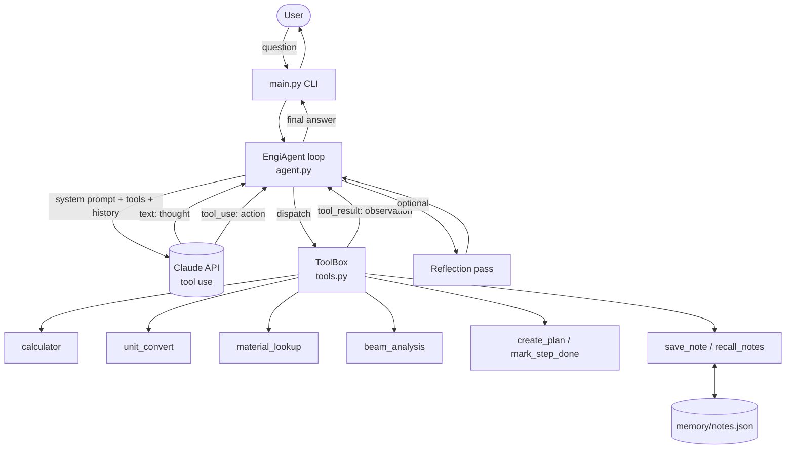

# EngiAgent - an Agentic AI for Engineering Problem Solving

A tool-using AI agent (Claude API) that plans multi-step engineering tasks, calls calculation tools instead of guessing numbers, remembers results across sessions, and can review its own answers.

**Author:** _Harish Chand Senthil (23BME1132)_

## Why it is an *agent* (not just a chatbot)

| Agentic capability | How it is implemented |
|---|---|
| Planning | `create_plan` / `mark_step_done` tools; the agent writes a plan before multi-step work |
| Tool use / action | 8 tools: calculator, unit conversion, material lookup, beam analysis, plan, notes |
| Observation and self-correction | Tool errors are returned to the model (`is_error`), which fixes inputs and retries |
| Short-term memory | Running message history inside one session |
| Long-term memory | `save_note` / `recall_notes` persisted to `memory/notes.json` |
| Reflection | Optional `--reflect` pass reviews the draft answer for unit/logic errors |
| Guardrails | Step limit, AST-whitelisted calculator (no `eval`), API key from `.env` |

## Architecture



More detail: [`docs/architecture.md`](docs/architecture.md) | Tool schemas: [`docs/tool_schema.json`](docs/tool_schema.json)

## Setup

```bash
git clone <your-repo-url>
cd engiagent
python -m venv .venv && source .venv/bin/activate     # Windows: .venv\Scripts\activate
pip install -r requirements.txt
cp .env.example .env                                   # then put your ANTHROPIC_API_KEY in .env
```

## Run

```bash
python main.py                      # interactive session
python main.py "A 1 m aluminium 6061-T6 simply supported beam, 20x40 mm section, carries 1 kN at mid-span. Find stress, deflection and safety factor." 
python main.py --reflect            # adds the self-review pass
```

The console shows the agent's trace: `[thought]`, `[action]`, `[observation]`.

## Example tasks

- "Convert 150 hp to kW and tell me the torque at 6000 rpm."  (uses `calculator`, `unit_convert`)
- "Compare 7075-T6 and Ti-6Al-4V for specific stiffness and specific strength."  (uses `material_lookup`, `calculator`)
- "Cantilever 0.5 m, 10x20 mm, 200 N at the tip, 6061-T6: is it safe?"  (uses `beam_analysis`, plan, memory)
- "Save that result." then, in a new session, "What did I save about the cantilever?"

## Tests

```bash
python -m pytest -q
```

The agent-loop tests use a scripted fake LLM, so they run without an API key or network.

## Project layout

```
main.py                 CLI entry point
engiagent/agent.py      agent loop, system prompt, reflection
engiagent/tools.py      tools + JSON schemas + ToolBox dispatcher
engiagent/memory.py     JSON-backed long-term memory
tests/                  unit tests for tools and the agent loop
docs/                   architecture + tool schema
```

## Limitations

- Material values are typical handbook numbers; always verify with a datasheet.
- Beam tool covers four standard load cases on rectangular sections only.
- Not a substitute for FEA or a checked design calculation.
