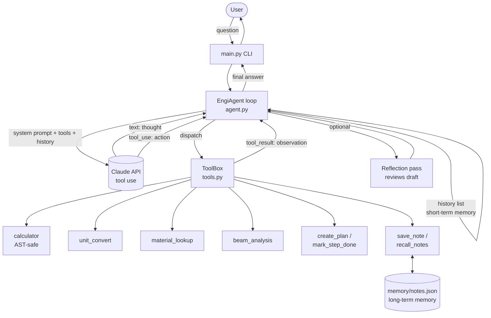

# EngiAgent - Architecture & Schema

## Agentic loop (ReAct-style)

1. **Plan** - the model calls `create_plan` for multi-step tasks.
2. **Act** - the model emits `tool_use` blocks; `ToolBox.run` executes them.
3. **Observe** - results (or errors, flagged `is_error`) are returned as `tool_result` blocks.
4. **Repeat** until the model stops calling tools, or `max_steps` is hit.
5. **Reflect** (optional `--reflect`) - a second call reviews the draft answer.

## Guardrails

- Step limit (`max_steps`, default 12) prevents infinite loops.
- Calculator uses a whitelisted AST evaluator - no `eval()`, no imports, bounded exponents.
- Tool errors never crash the agent; they are returned to the model so it can retry.
- API key lives in `.env` (git-ignored), never in code.

Tool JSON schemas: [`tool_schema.json`](tool_schema.json).
